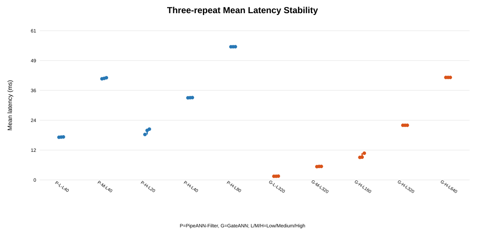
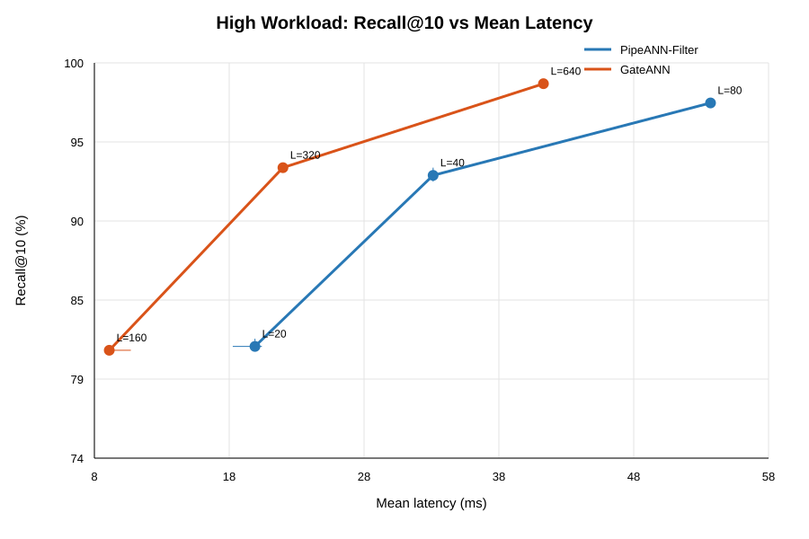
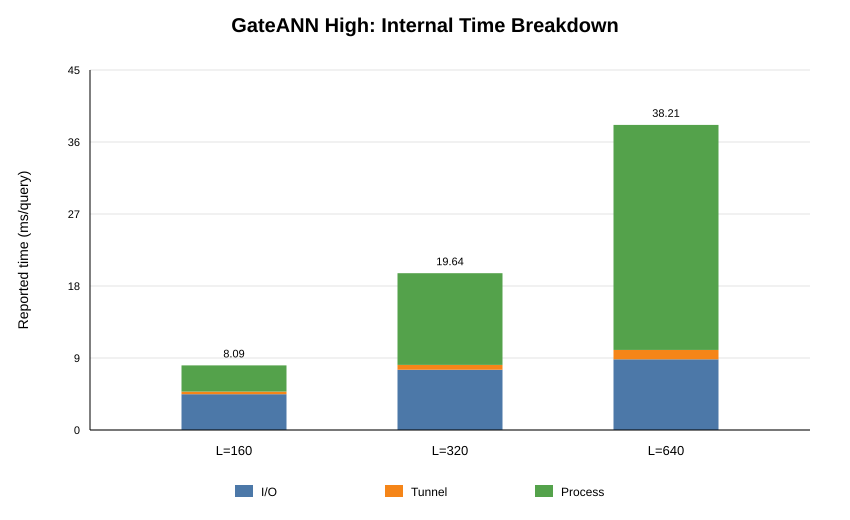
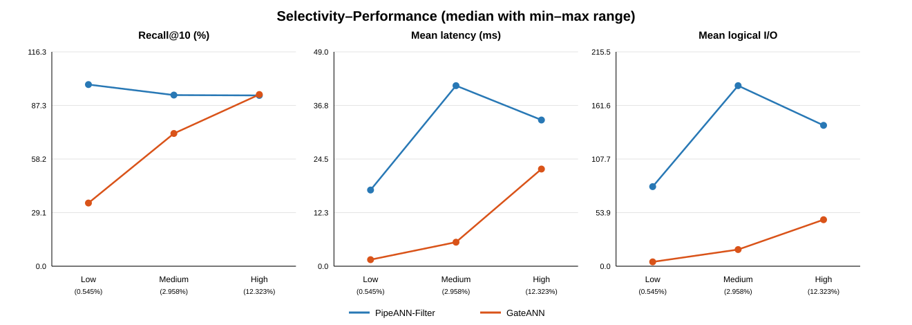
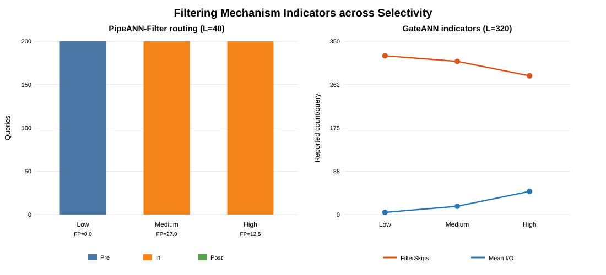
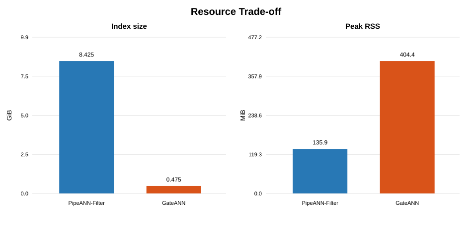

# 基于 SSD 的过滤向量检索系统性能测试与设计比较

姓名：________　学号：________　班级：________

实验日期：2026 年 10 月 14 日  
正式实验编号：`20261014-175759`

## 1. 实验环境与复现结果

### 1.1 实验环境

| 项目 | 实际环境 |
|---|---|
| 计算平台 | 阿里云 ECS，杭州地域，通用算力型 u1，KVM 虚拟机 |
| CPU | Intel Xeon Platinum，系统未报告具体型号后缀；4 vCPU，虚拟拓扑为 1 socket、2 cores、2 threads/core |
| 内存 | 配置 8 GiB，系统显示约 7.3 GiB；Swap=0 |
| SSD 与文件系统 | ESSD Entry 40 GiB 云盘；`/dev/vda3`，ext4，挂载 `/` |
| 操作系统 | Ubuntu 22.04.5 LTS |
| 内核 | Linux 5.15.0-191-generic，x86_64 |
| 编译器 | GCC/G++ 11.4.0 |
| 课程仓库 Commit | `e44eab5d1b040ffdebc80374a13b304a9c4d37de` |
| PipeANN-Filter Commit | `2ec84fe20c37dc3cc236b66f7eba31c0cc80bf1e` |
| GateANN Commit | `71e87cbf0e25c0400c0109dd25a64a7c4dccc9dd` |
| I/O Backend | Linux AIO |
| 公共查询参数 | threads=1，beamwidth=8，K=10，mem_L=0，cache budget=0 |
| GateANN FullAdj 参数 | neighbors=32 |
| 正式 experiment-id | `20261014-175759` |

两套系统在同一实例、同一系统云盘中运行，未改变课程规定的正式查询参数。ESSD Entry 是云块存储，不是本地直连 NVMe SSD；虚拟块设备的 `ROTA` 标志和空白 `MODEL` 字段不能作为物理介质型号依据。实验后的磁盘快照为总计 40G、已用 17G、可用 22G，内存 available 约 6.6 GiB，无 Swap。该快照仅说明实验后的资源状态，不代替查询子进程峰值测量。

课程建议 16 GiB 内存，本次实际配置为 8 GiB。正式阶段使用预构建索引且全部查询成功结束，因而未升级配置或增加 Swap；报告结论限定于本次实际环境。

选择同一实例和同一云盘的目的，是尽量减少硬件差异对系统比较的干扰。CPU、内存容量、文件系统和 I/O 后端保持一致后，测得差异更可能来自索引布局、过滤位置及搜索策略。不过，云主机仍可能受到宿主机调度和共享存储负载影响，因此后文使用三轮中位数描述典型水平，并保留最小值和最大值反映波动，而不将单次最快结果作为最终结论。

**Debug 正确性验证**

先顺序编译两套系统，再分别构建 10 万向量 Debug 索引。编译并发设为 `FVS_BUILD_JOBS=2`，Debug 构建线程设为 2；这两项不改变正式查询的单线程参数。Debug 验证标识为 `debug-check-20261014-122107`：

| 系统 | 查询数 | L | Recall@10 | 验证结果 |
|---|---:|---:|---:|---|
| PipeANN-Filter | 200 | 40 | 96.70% | PASS |
| GateANN | 200 | 320 | 95.20% | PASS |

最终输出 `DEBUG CORRECTNESS CHECK PASS`。两套正式预构建索引也分别通过 manifest 和内容校验。Debug 指标仅证明环境、构建和查询链路可用，不参与正式性能排名。

该验证阶段的作用可以分为两层。第一层是功能正确性，即程序能够读取数据、加载索引、执行带标签条件的查询并生成可解析结果；第二层是结果合理性，即 Recall 达到课程检查阈值，排除索引损坏、参数路径错误或 Ground Truth 不匹配等明显问题。只有这两层都通过后，正式阶段的延迟和 I/O 数据才具有分析意义。

**修改说明与准备问题**

未自行修改课程正式实验脚本、搜索算法或统一查询参数。GateANN 准备脚本自动应用课程提供的 `gateann_aio_compat.patch`，仅修正 AIO control block 数组访问，属于编译兼容补丁。环境文件记录其 SHA-256 为 `d90657151bf1adc735bc6916e4120690a64288281fe76ac24ad2e4a859662bc1`。本地新增的分析脚本只处理已有 CSV，不修改原始测量结果。

准备过程中曾因包名错误遇到 `Unable to locate package libgoogle-perftools`，修正为 `libgoogle-perftools-dev` 并分批安装后编译成功。GitHub Release 下载缓慢且出现 HTTP/2 `PROTOCOL_ERROR`，正式 PipeANN 压缩包约 45 分钟仅下载 50 MiB，随后改用课程夸克备用源获取压缩包，再通过原脚本进行 SHA-256 校验、解压和索引验证。下载来源改变不涉及数据内容或实验参数改变。长任务在 tmux `fvs` 会话中运行，以防本地终端断开导致任务终止。

## 2. 系统设计理解

过滤向量检索需要同时满足“向量距离接近”和“元数据条件成立”两个要求。若先在全部向量上完成近邻搜索再过滤，返回的候选可能大量不满足标签条件；若先严格筛出匹配对象再搜索，又可能破坏原图索引的连通性，并在强过滤时面对非常小的候选集合。因此，系统设计的关键不是简单增加一次布尔判断，而是决定过滤发生在搜索的哪个阶段、如何跨越不匹配节点，以及为此在 DRAM 和 SSD 上保存哪些辅助结构。

### 2.1 PipeANN-Filter

PipeANN 的基础设计面向 SSD 驻留图搜索：将压缩向量等用于候选估计的结构置于 DRAM，将完整向量与磁盘图组织在 SSD 中，通过放宽传统 Best-First Search 中计算与 I/O 的严格串行依赖，使候选处理与异步读取形成流水线。其目的不是简单增加读取量，而是让搜索过程持续提供可执行工作，减少计算或 SSD 等待造成的空闲。PipeANN-Filter 在此基础上增加推测式过滤：内存中的紧凑属性摘要允许一定假阳性，先搜索满足谓词的超集，随后进行精确属性验证；论文利用属性与向量共置等方式复用候选精确处理所需的读取。该设计减少反复访问磁盘属性的成本，但摘要误判和额外候选会带来计算或 I/O 代价。[PipeANN 论文](https://www.usenix.org/conference/osdi25/presentation/guo)、[PipeANN-Filter 论文](https://arxiv.org/abs/2605.17992)。

一次过滤查询先接收向量和标签谓词，通过选择率及估计成本选择 Pre-filter、In-filter 或 Post-filter 路径：Pre-filter 先限定满足条件的候选集合；In-filter 在图搜索中使用过滤判断和推测信息；Post-filter 先检索后验证、筛选候选。候选扩展、PQ 距离估计、SSD 读取和精确处理在对应路径中配合执行，最终返回满足条件的 top-K。本次课程负载下，Low 的全部查询选择 Pre-filter，Medium 和 High 的全部查询选择 In-filter，未观察到 Post-filter 路由。路由选择能够适应不同过滤强度，但成本估计误差、过滤假阳性及被过滤节点所承担的图连接作用会影响效率和可达性。官方源码阅读入口为 `tests/search_disk_index_filtered.cpp`、`src/search/pipe_search.cpp`、`src/search/spec_filter_search.cpp` 与 `include/filter/`，本次不声称所有论文可选表示或路径都被实际执行。[固定版本源码](https://github.com/thustorage/PipeANN/tree/2ec84fe20c37dc3cc236b66f7eba31c0cc80bf1e)。

### 2.2 GateANN

GateANN 将过滤判断放到 SSD I/O 之前。DRAM 中保存 PQ 压缩向量、过滤元数据和可用于邻接遍历的 FullAdj 结构；完整向量等精确检索数据仍由磁盘索引提供。本次日志显示 SpmatFilterStore 含 100 万节点、10,832,801 个标签关联，报告大小 49.0 MB；FullAdjIndex 含 100 万节点，日志报告约 0.122935 GB，通过 `mmap(MAP_POPULATE)` 加载。Pre-I/O Filtering 在提交读取前检查候选标签，避免为不满足条件的节点读取完整向量。[GateANN 论文](https://arxiv.org/abs/2603.21466)。

仅跳过不匹配节点可能破坏可达性，因此 GateANN 使用 Graph Tunneling：即使节点不满足过滤条件，仍可利用内存邻接结构继续穿过该节点拓展搜索，而不必为该节点读取完整 SSD 数据。查询依次进行候选生成、内存过滤、隧穿扩展、匹配节点读取和距离处理，再维护满足条件的结果集合。这使图遍历与完整向量读取解耦，预期减少无效 I/O，同时保留跨不匹配节点的路径；代价是额外 DRAM 邻接/标签结构、构建或加载成本以及候选处理和隧穿计算。隧穿机制缓解可达性问题，但有限搜索预算并不保证所有过滤强度下都维持高 Recall。官方源码入口为 `tests/search_disk_index_yfcc.cpp`、`src/search/pipe_search.cpp`、`include/utils/spmat_filter_store.h` 和 `include/utils/full_adj_index.h`。[固定版本源码](https://github.com/GyuyeongKim/GateANN-public/tree/71e87cbf0e25c0400c0109dd25a64a7c4dccc9dd)。

**两套系统设计比较**

| 系统 | 过滤查询机制 | DRAM 主要结构 | SSD 主要结构 | 预期优势 | 潜在代价 |
|---|---|---|---|---|---|
| PipeANN-Filter | 推测过滤；Pre/In/Post 成本路由 | PQ、候选队列、过滤摘要或属性辅助结构 | 完整向量、磁盘图、精确验证所需数据 | 流水化隐藏等待；按工作负载选择路径 | 假阳性处理；路由估计误差；磁盘布局空间 |
| GateANN | Pre-I/O Filtering；Graph Tunneling | PQ、标签稀疏存储、FullAdj、候选队列 | 完整向量及磁盘索引 | 避免无效读取；内存隧穿保持图遍历 | DRAM、初始化和隧穿处理；预算不足时质量下降 |

核心区别在于减少开销的位置。PipeANN-Filter 通过紧凑过滤判断和路径选择协调搜索、验证与 I/O；GateANN 则在读取前过滤，并使用内存邻接结构跨越不匹配节点。前者强调过滤成本与流水化搜索的适配，后者强调图遍历和 SSD 数据访问解耦。两者均需处理过滤后的可达性问题，但资源承担方式不同；实际优劣必须联合 Recall、延迟和资源测量判断。

从一次查询的数据流看，PipeANN-Filter 更像是根据查询特征选择合适的处理路线，再在路线内部协调候选扩展、过滤和读取；GateANN 则先在内存中判断候选是否值得发起 I/O，不匹配时利用 FullAdj 继续遍历。两种思路都试图减少“对最终结果无贡献的工作”，但前者可能承担推测过滤的假阳性和更大的磁盘布局，后者可能承担额外内存驻留以及隧穿计算。这个差异也为后文的资源结果提供了设计层面的解释。

## 3. 实验方法

**数据和 Workload**

使用 `YFCC Filtered Vector Search Course Dataset v1`，向量为 192 维 uint8，距离为 L2。Debug 为 10 万 Base 向量，Formal 为 100 万 Base 向量。过滤语义为 `selected_label in point_labels`，每条查询选择一个真实标签。每档 200 条查询，由 5 个标签各 40 条组成，提供过滤后的精确 L2 top-100 Ground Truth；Recall@10 由系统基于返回 top-10 与 Ground Truth 计算。

这里的 Selectivity 表示满足标签条件的 Base 向量占全部 Base 向量的比例。比例越低，过滤越强，系统越难在有限探索范围内找到足够多的有效近邻。Low、Medium 和 High 因而分别对应强、中、弱过滤，而不是数据规模的高低。每档使用相同查询数并保持标签数量均衡，有助于避免某一档仅因查询条数更多而产生更高总耗时。

| Bucket | Selectivity 范围 | 中位数 | 过滤强度 |
|---|---:|---:|---|
| Low | 0.2499%–0.8513% | 0.5450% | 强 |
| Medium | 1.7652%–4.9947% | 2.9576% | 中 |
| High | 7.0738%–17.0890% | 12.3232% | 弱 |

**参数、重复与统计**

High：PipeANN-Filter L=20/40/80，GateANN L=160/320/640；Low 和 Medium：分别固定 L=40 和 L=320。High 的代表性配置同时用于 Selectivity 图，不重复运行。每轮 10 行，三轮共 30 行。按 `system + bucket + L` 分组，共 10 组，每组重复编号 1、2、3；中心值采用三轮中位数，波动采用最小值–最大值。缺失的系统专有字段保持空值，不补成 0。

延迟使用聚合 CSV 的 `mean_latency_us`，换算 ms；不以包含初始化的 `elapsed_seconds/queries` 替代查询延迟。PipeANN 的延迟直接来自查询输出；GateANN 课程适配器以 `1,000,000/QPS` 换算，且日志 QPS 为整数。因此 GateANN 个别组的三轮延迟相同可能受输出精度限制，不表示底层执行完全没有波动。三轮范围是描述性范围，不是置信区间。

两套系统的 L 尺度和执行方式不同，不能以相同 L 保证公平。系统间延迟比较选取 Recall 接近的实际点，同时给出各自 Recall，不把质量不同的点宣称为严格等质量加速。

本实验把 Recall@10 作为首要质量约束，把 Mean Latency 作为主要性能指标。QPS 与平均延迟在单线程环境下大体互为倒数，用于从吞吐角度核对结果；Mean I/O、FilterSkips、内部时间和峰值 RSS 则用于解释结果，而不单独作为系统优劣标准。这样的指标分层可以避免出现“通过少做搜索获得高 QPS，却忽略召回率下降”的片面判断。

具体分析流程为：先检查每组的三次重复是否齐全，再按配置计算中位数和范围；随后在 High 档绘制 Recall–Latency 曲线，寻找两套系统质量接近的测量点；再固定各自代表性 L 比较不同 Selectivity；最后结合内部计数和资源占用解释趋势。该顺序先确认数据可靠性，再讨论性能与机制，减少由单个异常运行直接推导系统结论的风险。

统一配置缓存预算为 0，但不等于操作系统页缓存为空。实验未额外执行清空页缓存操作，也未进行严格冷缓存/热缓存对照。运行期间按要求避免自行启动并发下载和编译，未采集宿主机后台负载的完整时间序列；云盘和虚拟机共享资源可能影响短查询批次的波动。

**主要复现命令**

以下在服务器 `/root/fvs-course-lab` 中执行：

```bash
FVS_BUILD_JOBS=2 bash scripts/prepare_pipeann.sh
FVS_BUILD_JOBS=2 bash scripts/prepare_gateann.sh

python3 adapters/pipeann_adapter.py build \
  --repo "$PWD/systems/PipeANN" \
  --dataset-root "$PWD/datasets/yfcc_course_v1" \
  --tier debug --run-root "$PWD/course_runs" --threads 2
python3 adapters/gateann_adapter.py build \
  --repo "$PWD/systems/GateANN-public" \
  --dataset-root "$PWD/datasets/yfcc_course_v1" \
  --tier debug --run-root "$PWD/course_runs" --threads 2

bash scripts/check_dataset.sh
bash scripts/run_debug_validation.sh
bash scripts/download_indexes.sh
bash scripts/check_indexes.sh
bash scripts/run_formal_experiments.sh
```

正式脚本结束时输出 `Collected and validated 30 rows` 和 `Formal experiments complete`。本地分析使用 `python analyze_formal_results.py`，原始 CSV、环境文件和逐轮日志均保留。

整个复现过程可概括为“环境准备—Debug 构建—正确性检查—正式索引校验—三轮查询—聚合分析”。正式查询直接使用课程提供并校验通过的百万级预构建索引，避免把两套系统不同的建索引时间混入查询阶段。分析脚本只读取实验输出并生成汇总表与图片，因此图表中的数值均可返回原始运行记录核对。

**完整性、控制变量与证据检查**

正式结果提交分析前进行了以下检查：

| 检查项 | 预期 | 实际结果 | 状态 |
|---|---:|---:|---|
| 聚合 CSV 总行数 | 30 | 30 | 通过 |
| 系统数 | 2 | PipeANN-Filter、GateANN | 通过 |
| `system+bucket+L` 组数 | 10 | 10 | 通过 |
| 每组重复次数 | 3 | 全部为 3 | 通过 |
| Tier | `formal_1000000` | 全部一致 | 通过 |
| 每档查询数 | 200 | 全部一致 | 通过 |
| K | 10 | 全部一致 | 通过 |
| threads | 1 | 全部一致 | 通过 |
| beamwidth | 8 | 全部一致 | 通过 |
| PipeANN Commit | `2ec84fe...` | 一致 | 通过 |
| GateANN Commit | `71e87cb...` | 一致 | 通过 |
| 索引字节数 | 同一系统保持一致 | PipeANN 9,046,323,396 B；GateANN 509,543,139 B | 通过 |

除聚合 CSV 外，每次运行均保留 `command.json`、`run.log` 和单次 `results.csv`；PipeANN 还保留 `filter_config.json`。环境证据包括 `environment.txt` 和另行保存的 `system_info.txt`。因此聚合表中的异常值可回溯至单轮原始命令和日志，而不是直接修改 CSV。

**三轮稳定性**



图6：每个配置展示三轮 Mean Latency；纵向线段为最小值–最大值。P/G 分别表示 PipeANN-Filter/GateANN，L/M/H 表示 Low/Medium/High。

多数配置三轮范围较窄。相对波动较明显的是 GateANN High L=160（9.174–10.870 ms，范围约占中位数 18.3%）和 PipeANN High L=20（18.477–20.647 ms，约 10.8%）；更高预算配置相对稳定。短批次只有 200 条查询，低延迟配置更容易受到计时粒度、云主机调度和共享存储波动影响，因此报告中心值使用中位数而不是最快一轮，并完整保留范围。

从结果用途看，这种重复规模足以发现明显的数量级差异，也能识别个别配置是否存在较大波动，但不足以进行严格的显著性检验或尾延迟建模。因此，正文中的百分比只描述本次测得运行点，不附加“统计显著”结论。若后续需要用于系统选型，应扩大查询批次与重复次数，并补充 P95、P99 等尾延迟指标。

## 4. 实验结果与机制分析

以下所有表格采用三轮中位数；方括号表示三轮最小值–最大值。

**Recall–Latency**



图1：横轴为查询平均延迟（ms），纵轴为 Recall@10（%）；分别连接两套系统三档 L，误差线为三轮最小–最大范围。

| 系统 | L | Recall@10（%） | Mean Latency（ms） | QPS | Mean I/O（次/查询） |
|---|---:|---:|---:|---:|---:|
| PipeANN-Filter | 20 | 81.60 [81.50–82.10] | 20.135 [18.477–20.647] | 49.6 [48.4–54.1] | 101.20 [100.30–101.30] |
| PipeANN-Filter | 40 | 92.70 [92.30–93.20] | 33.432 [33.380–33.474] | 29.9 [29.9–29.9] | 141.60 [141.60–141.80] |
| PipeANN-Filter | 80 | 97.40 [97.30–97.50] | 54.138 [54.124–54.149] | 18.5 [18.5–18.5] | 229.60 [229.60–229.60] |
| GateANN | 160 | 81.35 [81.30–81.35] | 9.259 [9.174–10.870] | 108 [92–109] | 24.66 [24.66–24.66] |
| GateANN | 320 | 93.20 [93.20–93.20] | 22.222 [22.222–22.222] | 45 [45–45] | 46.75 [46.74–46.76] |
| GateANN | 640 | 98.65 [98.65–98.65] | 41.667 [41.667–41.667] | 24 [24–24] | 88.94 [88.93–88.94] |

提高预算对两套系统都有明确收益和代价。PipeANN L=20→80，Recall 提高 15.80 个百分点，延迟增至约 2.69 倍，逻辑 I/O 增至约 2.27 倍；GateANN L=160→640，Recall 提高 17.30 个百分点，延迟增至约 4.50 倍，逻辑 I/O 增至约 3.61 倍。预算扩大使搜索覆盖更多候选，提高命中精确近邻的概率，但增加读取和候选处理。最高预算仍不是免费提高质量。

曲线整体向“高 Recall、高延迟”方向移动，符合近似检索的基本权衡。值得注意的是，L 并不是跨系统统一的工作量单位：它会通过各自的候选队列、扩展逻辑和过滤机制转化为不同数量的比较与读取。因此，图1的意义在于观察每套系统自己的质量—延迟曲线，并在实际测得的邻近质量点横向比较，而不是比较相同数字的 L。

在约 81% Recall 点，GateANN 的 81.35%、9.259 ms 对应 PipeANN 的 81.60%、20.135 ms，测得延迟约低 54.0%；在约 93% 点，GateANN 的 93.20%、22.222 ms 对应 PipeANN 的 92.70%、33.432 ms，约低 33.5%。这支持“本次 High workload、这些相近 Recall 点上 GateANN 延迟较低”的结论。最高预算 Recall 相差 1.25 个百分点，不将其用于严格等质量加速比。

GateANN High 内部指标进一步显示预算增大后的开销结构：

| L | FilterSkips | IO time（μs） | Tunnel time（μs） | Process time（μs） |
|---:|---:|---:|---:|---:|
| 160 | 143.16 [143.13–143.19] | 4484 [4394–5274] | 330 [327–347] | 3279 [3228–3859] |
| 320 | 280.24 [280.24–280.25] | 7551 [7530–7552] | 603 [600–615] | 11486 [11430–11539] |
| 640 | 557.09 [557.07–557.09] | 8857 [8813–8900] | 1171 [1159–1176] | 28185 [28083–28234] |



图3：GateANN High 三档 L 的内部 I/O、Tunnel 与 Process time 中位数堆叠展示。堆叠总高度仅用于观察内部报告量随预算的变化，不视为端到端延迟的严格分解。

从 L=320 到 640，Process time 增长远大于 IO time，提示高预算时开销不能仅归因于 SSD，候选处理可能成为更显著的约束。这些是系统内部计时，存在重叠、未覆盖阶段和统计口径差异，不能直接相加重建总延迟或当作严格时间占比。

PipeANN High 全部走 In-filter，过滤假阳性指标随 L=20/40/80 为 8.6/12.5/19.2，随预算增加的额外候选处理与读取也可能贡献开销。不过该指标不是独立测得的假阳性概率，不据此直接计算误判率。

`mean_ios` 是各系统内部逻辑 I/O。日志中 PipeANN 的相关 I/O 大小为 8192 字节，GateANN 为 4096 字节，且实现统计口径可能不同；不能把上表次数直接等同物理 I/O，更不能仅凭次数判优。

**Selectivity–Performance**



图2：固定 PipeANN L=40、GateANN L=320，横轴为 Low/Medium/High，并标出实际选择率中位数；三个子图分别为 Recall、Mean Latency 和 Mean I/O。误差线表示三轮范围。

| 系统 | Bucket | Selectivity min/median/max（%） | Recall@10（%） | Mean Latency（ms） | Mean I/O |
|---|---|---:|---:|---:|---:|
| PipeANN-Filter | Low | 0.2499/0.5450/0.8513 | 98.60 [98.60–98.60] | 17.424 [17.352–17.485] | 80.00 [80.00–80.00] |
| PipeANN-Filter | Medium | 1.7652/2.9576/4.9947 | 92.90 [92.80–93.10] | 41.284 [41.108–41.537] | 181.50 [180.40–182.60] |
| PipeANN-Filter | High | 7.0738/12.3232/17.0890 | 92.70 [92.30–93.20] | 33.432 [33.380–33.474] | 141.60 [141.60–141.80] |
| GateANN | Low | 0.2499/0.5450/0.8513 | 34.30 [34.30–34.30] | 1.497 [1.488–1.548] | 4.38 [4.38–4.38] |
| GateANN | Medium | 1.7652/2.9576/4.9947 | 72.05 [72.05–72.05] | 5.495 [5.405–5.495] | 16.75 [16.75–16.75] |
| GateANN | High | 7.0738/12.3232/17.0890 | 93.20 [93.20–93.20] | 22.222 [22.222–22.222] | 46.75 [46.74–46.76] |

对应 QPS 中位数/范围：PipeANN Low 57.4 [57.2–57.6]，Medium 24.2 [24.0–24.3]，High 29.9 [29.9–29.9]；GateANN Low 668 [646–672]，Medium 182 [182–185]，High 45 [45–45]。

| 系统 | Bucket | 路由 Pre/In/Post（查询数） | 假阳性指标 | FilterSkips | Tunnel time（μs） |
|---|---|---:|---:|---:|---:|
| PipeANN-Filter | Low | 200/0/0 | 0.0 | 不适用 | 不适用 |
| PipeANN-Filter | Medium | 0/200/0 | 27.0 [26.9–27.1] | 不适用 | 不适用 |
| PipeANN-Filter | High | 0/200/0 | 12.5 [12.4–12.6] | 不适用 | 不适用 |
| GateANN | Low | 不适用 | 不适用 | 320.72 [320.71–320.73] | 558 [546–571] |
| GateANN | Medium | 不适用 | 不适用 | 309.41 [309.40–309.42] | 588 [584–595] |
| GateANN | High | 不适用 | 不适用 | 280.24 [280.24–280.25] | 603 [600–615] |



图4：左侧为 PipeANN-Filter 在三档 Selectivity 下的 Pre/In/Post 路由数，并标注假阳性指标；右侧为 GateANN 的 FilterSkips 与 Mean I/O。两个 GateANN 指标共用“次/查询”纵轴，但属于不同内部事件，不应相减或相除解释。

GateANN 在过滤变强时读取更少、延迟更低，但质量也下降：High→Low，Recall 从 93.20% 降至 34.30%，FilterSkips 上升，逻辑 I/O 从 46.75 降至 4.38。Pre-I/O Filtering 解释了避免无效读取的趋势；有限搜索预算下，满足条件的候选稀少，隧穿和候选探索可能不足以覆盖精确近邻。这是机制支持的假设，不是已证明的唯一原因。不能将 Low 的高 QPS 表述为同等质量下的优势。

PipeANN 表现不是随选择率单调变化。Low 全部采用 Pre-filter，Recall 98.60%，比 Medium/High 更高且更快；Medium/High 全部采用 In-filter，Medium 逻辑 I/O、假阳性指标和延迟都更高。路由变化与更强过滤下限定候选集合的处理方式一致，说明成本路由对本次 Low 有效。Medium 的候选分布和推测误判可能增加搜索工作量，但标签频率、语义与向量分布同时变化，不能把差异完全归因于 Selectivity。

这一结果还说明，选择率与查询难度并非简单的线性关系。强过滤虽然减少了符合条件的数据量，但如果系统能够先得到一个规模较小且准确的候选集合，后续搜索反而可能更直接；相反，中等选择率既不足以让 Pre-filter 成本占优，又可能使 In-filter 处理较多推测候选。由于三个分桶包含不同标签，本实验只能确认这种现象与路由和内部计数一致，不能据此断言存在普遍的“Medium 最慢”规律。

**资源 Trade-off**

索引大小以 `index_bytes/1024^3` 计算，峰值 RSS 以 `peak_rss_kb/1024` 转为 MiB。同一系统各配置索引字节数一致。High 的三档 L 由同一次查询子进程运行，峰值 RSS 是该进程峰值，不能分别归因于某一 L。

| 系统 | 索引大小（GiB） | High 峰值 RSS（MiB） | Medium 峰值 RSS（MiB） | Low 峰值 RSS（MiB） |
|---|---:|---:|---:|---:|
| PipeANN-Filter | 8.425 | 135.95 [135.79–136.03] | 135.91 [135.86–135.96] | 135.68 [135.65–136.05] |
| GateANN | 0.475 | 404.37 [404.32–404.38] | 404.36 [404.36–404.37] | 407.17 [404.39–407.42] |



图5：左图为课程正式索引实际文件大小，右图为各配置峰值 RSS 中位数的中位数，用于突出 SSD 空间与 DRAM 使用的相反趋势。具体配置范围以上表为准。

PipeANN 磁盘索引约为 GateANN 的 17.75 倍，而 GateANN 的 High 查询峰值 RSS 约为 PipeANN 的 2.97 倍。前者以更大磁盘占用和较低进程 RSS 完成检索；后者借助内存标签和邻接信息减少过滤不匹配节点的读取，在 High 相近 Recall 点获得更低延迟，但需要更多 DRAM。本次 GateANN FullAdj 和 SpmatFilterStore 日志能够说明额外结构存在，却不足以将全部 RSS 差值归因于它们：PQ、缓冲区、内存分配和 mmap 驻留均可能贡献峰值。

索引大小比较包含课程包的实际文件和布局，不等于理论上所有实现的最低存储量。不能凭这组数据断言 PipeANN 的所有空间开销均为过滤导致，或 GateANN 在所有选择率下更划算。Low 的低 Recall 说明资源节约必须与质量要求联合评估。

若从部署角度理解，磁盘空间和 DRAM 并不能直接按单一价格互换。更大的索引会影响实例磁盘容量、下载与部署时间，更多的常驻内存则会限制同机并发查询进程数量。当前实验只运行单查询线程，因此没有测量多租户或高并发下的内存压力；表中的资源数据适合说明两套实现的侧重点，不足以直接估算生产环境总成本。

**关键现象与瓶颈总结**

**现象一：High 相近 Recall 下 GateANN 延迟更低。** 测量事实为约 93% Recall 点的 22.222 ms 对 33.432 ms。其过滤前置和内存隧穿能够避免部分不匹配节点的完整读取，内部 FilterSkips 支持这一解释。但物理 I/O 和缓存状态没有独立测量，故不能证明全部收益来自磁盘读取减少。

**现象二：GateANN 强过滤时低延迟伴随低 Recall。** Low 的 Recall 34.30%、延迟 1.497 ms、Mean I/O 4.38；结合稀少匹配候选和有限搜索预算，推断潜在瓶颈在于有效候选覆盖/图探索充分性，而不是单纯 I/O 速度。只有扩展预算或控制隧穿策略的补充实验才能区分预算不足、可达性和候选排序等原因。

**现象三：PipeANN Medium 的 In-filter 开销较高。** 在相同 L=40 下，Medium 延迟 41.284 ms，High 为 33.432 ms；Mean I/O 和假阳性指标同步增加，支持额外候选处理和读取成本的判断。由于真实标签差异，仍需同标签对照或路由诊断验证因果。

**现象四：GateANN 高预算的处理开销增长明显。** High L=320→640 时 Process time 由 11486 增至 28185 μs，而 IO time 由 7551 增至 8857 μs。候选管理和距离处理值得优化，但需要 profiling 区分具体模块，不能仅凭一个内部时间字段确定 CPU 瓶颈。

综合四个现象，本次实验揭示的是一个三方约束：搜索预算决定候选探索充分程度，过滤机制决定无效候选如何被跳过或验证，资源布局决定这些操作由 SSD 还是 DRAM 承担。只优化其中一项可能把开销转移到另一项。例如，GateANN 减少读取后可能增加内存结构和候选处理，PipeANN-Filter 保持强过滤质量则需要更大的磁盘索引。评价系统时必须把 Recall 作为约束，再比较延迟与资源，而不能先按最低延迟排序。

## 5. 优化方向设计

本节直接使用任务二数据，未开展或声称完成补充实验。选择 GateANN，研究强过滤工作负载的质量—开销失衡。

**Observation**

固定 L=320 时，Low Recall 34.30%、Medium 72.05%、High 93.20%；相应延迟为 1.497、5.495 和 22.222 ms。Low 中 FilterSkips=320.72、Mean I/O=4.38，说明很少候选发生读取，却未保持足够质量。High 扩大 L 可提高 Recall，但 Process time 明显增加，提示不能无约束扩大预算。

**Mechanism**

Pre-I/O Filtering 排除不匹配节点的读取，Graph Tunneling 通过 FullAdj 保留跨节点遍历。在强过滤条件下，匹配候选比例更低；即使隧穿保持路径，固定预算仍可能难以搜索足够多且足够近的匹配节点。应重点分析官方 `src/search/pipe_search.cpp` 的候选扩展/终止路径、`spmat_filter_store.h` 的匹配判断和 `full_adj_index.h` 的邻接访问，并结合候选计数进行验证。

**Bottleneck**

已测得的结论是：默认预算下 Low Recall 很低，同时 I/O 少、延迟低。待验证假设是：固定搜索预算未随选择率调整，限制了有效候选覆盖。尚未证明是隧穿深度、候选队列容量还是近邻排序导致，亦未证明单独增加 L 足够解决。

**Optimization**

提出“选择率感知的自适应搜索预算”：先以现有标签频率或匹配集合大小估计选择率，低选择率查询从较高探索预算开始；运行中依据有效候选数量、候选距离改进及跳过比例，逐阶段增加搜索预算，直至满足停止条件或达到硬上限。优先调整候选扩展和停止策略，保留原 Pre-I/O Filtering、Graph Tunneling 和索引格式。

在实现层面，可将方案分为离线和在线两部分。离线阶段统计各标签的出现频率，并用独立校准查询确定不同选择率区间的初始预算和最大预算；在线阶段读取查询标签后选择初始档位，每完成一段候选扩展便检查有效结果数量及距离是否趋于稳定。若条件不足则继续扩大预算，若达到稳定条件则提前结束。这样只改动查询控制逻辑，不要求重新组织完整向量或重建磁盘图，便于与原版 GateANN 做单变量对照。

不能只以“已找到 K 个匹配结果”停止，因为数量达到 K 不代表 Recall 足够。停止条件应结合候选质量稳定性，且必须离线用 Ground Truth 校准；在线查询不能使用 Ground Truth 或真实 Recall。

**Expected Benefit**

主要目标是提高 Low/Medium 的 Recall，而非进一步降低已经很低的 Low 延迟。在目标 Recall≥90% 的约束下，争取比全体查询统一采用很大 L 更低的平均延迟、I/O 和处理成本；High 若已有足够质量，可继续采用较小预算。是否达标需要实验验证，不能预先宣称优化收益。

**Trade-off**

更大预算会提高 PQ 比较、候选队列管理、隧穿和匹配节点读取开销，可能增加尾延迟和临时内存。频率统计带来少量 DRAM 与维护成本；阈值校准增加实现复杂度，估计误差和标签分布变化可能导致过度探索或过早停止。若仅改变查询预算而不新增磁盘结构，预期无需扩大磁盘索引，但仍需实际检查峰值内存及运行时间。

**Validation Plan**

1. **问题与假设。** 首先检验增加预算是否能显著改善强过滤 Recall；若不能，则“默认预算不足”解释不充分，应转向图可达性或候选排序问题。
2. **基线。** 保留原 GateANN L=320、现有预构建索引与三档查询。先进行固定 L 扫描，例如 320/640/1280/2560，每次仅改变 L，不同时修改隧穿策略。
3. **自适应对照。** 若扫描确认质量随预算改善，再比较默认固定预算、达到目标质量的固定大预算、自适应策略。独立设置候选预算上限及阈值，使用预先划分的校准查询选择规则，在未参与校准的查询上评估，避免按测试结果挑选阈值。
4. **控制变量。** 同一 ECS、云盘、Formal 索引、标签查询、K=10、threads=1、beamwidth=8、AIO、缓存预算和运行顺序管理；不启动并发下载/编译。固定缓存处理方案，并记录是否清缓存。
5. **指标与重复。** 至少三轮，报告 Recall、Mean Latency、QPS、逻辑 I/O、FilterSkips、Tunnel/Process time、峰值 RSS；如实现支持再记录有效候选数量与尾延迟。继续使用中位数及范围。
6. **支持或否定标准。** 若 Low 达到目标 Recall，自适应策略在质量相近条件下比固定大预算具有更低延迟或处理开销，且 High 没有明显回退，支持该方案；若增大 L 后 Recall 仍低、开销过高或自适应规则不稳定，则否定或缩小方案适用范围。目标无法达到时如实报告，不选择最快但低 Recall 的点替代。

## 6. 实验总结与结论

本次成功复现两套系统，完成 Debug 验证、正式索引校验和 30 行三轮正式实验。PipeANN-Filter 以推测过滤和路径路由协调 SSD 流水化搜索；GateANN 以读取前过滤和内存图隧穿减少不匹配候选的完整读取。二者的区别同时体现在过滤位置、可达性维护和资源使用方式。

High workload 的相近 Recall 点上，GateANN 本次延迟更低；但 Low/Medium 的固定预算结果不能外推为同质量优势，尤其 Low Recall 只有 34.30%。PipeANN 的 Low Pre-filter 在本次查询中兼顾高 Recall 和较低延迟，而 Medium In-filter 的额外候选与 I/O 成本值得进一步研究。

在本次配置中，GateANN 适合能够提供约 400 MiB 查询内存、且在较弱过滤下要求较低延迟的场景；PipeANN 的路由设计在本次强过滤查询中具有明显质量优势，但使用更大磁盘索引。这些是基于当前标签和参数的适用性判断，不构成所有数据集的系统排名。提出的自适应预算方案旨在缓解 GateANN 强过滤时质量不足，收益与代价仍需按验证计划检验。

实验局限包括云盘及虚拟化环境、每档仅 200 查询、三轮重复、缓存与宿主机负载未严格隔离、真实标签分桶多因素变化、GateANN 延迟换算的输出精度和跨系统逻辑 I/O 口径差异。通过实验可见，SSD 过滤向量检索的优化必须共同考虑候选质量、图可达性、计算、I/O 和资源；单独减少读取或提高 QPS 不足以说明整体检索更优。

总体而言，本实验完成了从系统复现、正确性验证、统一测量到机制解释的完整流程。最明确的结论有三点：第一，在本次 High 工作负载的相近 Recall 点上，GateANN 取得更低平均延迟；第二，在强过滤且预算固定时，GateANN 的低 I/O 与低延迟伴随明显质量损失；第三，PipeANN-Filter 和 GateANN 分别以磁盘空间和内存空间换取其过滤能力，部署选择应结合质量目标和资源条件。后续最有价值的工作不是继续追求单个最快点，而是验证自适应预算能否在 Recall≥90% 的前提下改善强过滤查询的综合开销。

**附录 A：实验过程问题、诊断与处理**

本附录记录会影响复现性的实际问题。它们不作为系统性能结论，但可用于解释环境准备和数据完整性如何得到保证。

| 阶段 | 现象或错误 | 判断依据 | 实际处理 | 结果 |
|---|---|---|---|---|
| 依赖安装 | `Unable to locate package libgoogle-perftools` | Ubuntu 包名不完整 | 改为 `libgoogle-perftools-dev`，用短命令分批安装 | 两套系统随后编译成功 |
| 数据下载 | `curl: (92) HTTP/2 stream ... PROTOCOL_ERROR` | 压缩包未完整，校验文件未出现 | 由课程脚本断点续传，不删除已有部分 | 数据集 SHA-256 和内容校验通过 |
| 正式索引下载 | 约 45 分 50 秒仅下载 50 MiB，随后再次 HTTP/2 中断 | GitHub 长连接慢且不稳定；磁盘仍有约 32G 可用 | 停止单个失败下载，改用课程夸克备用源；不并发下载，不自行解压 | 原脚本 SHA-256、manifest 和内容校验全部通过 |
| SSH 上传 | Windows `scp` 返回 `Permission denied (publickey)` | 22 端口连通但服务器仅接受公钥 | 未修改 SSH 安全策略；使用阿里云网页文件管理完成传输 | 压缩包正确放入 downloads 目录 |
| tmux | `duplicate session: fvs` | 同名会话已存在，不代表已经进入会话 | `tmux attach -t fvs` 恢复；`Ctrl+B` 后 `D` 分离 | 长任务在服务器后台保持运行 |
| 终端显示 | 日志出现 `^[[A`、`^[[B` | 方向键 ANSI 转义序列 | 停止用方向键翻历史，改用滚动条 | 不影响程序或文件内容 |
| 内存配置 | 机器仅 8 GiB，低于课程建议 16 GiB | 系统 available 和无 Swap 状态已记录 | 编译并发和 Debug 构建线程设为 2；正式查询保持课程参数 | 无 OOM，正式实验完成 |

上述下载问题只改变获取完整压缩包的渠道；最终文件由课程给定的 SHA-256 和索引检查脚本验证，因此没有把未校验文件用于实验。环境准备命令、失败输出和最终验证均保留在继续操作记录中。

**附录 B：有效性威胁与解释边界**

**B.1 内部有效性**

- 正式脚本统一参数并验证30行结构，减少手工录入和配置混淆；但未记录宿主机负载时间序列，云上邻居负载可能影响延迟。
- 未主动清空操作系统页缓存。三轮可能共享缓存状态，因而结果代表课程脚本在当前执行条件下的表现，而不是严格冷盘或稳态热盘基准。
- High 三档 L 在同一系统进程中输出，峰值 RSS 和部分初始化成本属于该进程，不能拆分到每个 L。
- GateANN Mean Latency 由整数 QPS 换算，限制三轮细微差异的可见性；图中相同误差线不应解释为零随机性。

**B.2 构念有效性**

- Recall@10 衡量结果质量，但不描述候选探索的全部行为；高 QPS 与低 I/O 必须在 Recall 条件下解释。
- `mean_ios` 为系统逻辑 I/O，不等于操作系统或设备物理 I/O；系统间页面大小也不同。
- `peak_rss_kb` 是整个子进程峰值，不能归因于单一内部数据结构。
- 内部 IO/Tunnel/Process time 可重叠或采用实现特定口径，不能简单相加为端到端延迟。

**B.3 外部有效性**

- 结果来自单个 YFCC 数据集、三档真实标签和单台 ECS；不能直接代表其他向量分布、标签相关性、原生 NVMe SSD 或不同并发度。
- ESSD Entry 是云盘，绝对延迟不宜与其他同学的本地 SSD 或不同云实例直接比较。
- Low/Medium/High 不只是频率变化，标签语义、向量分布和查询难度也变化，因此跨档趋势不是纯 Selectivity 因果效应。

**B.4 统计结论有效性**

- 每配置三轮、每档 200 查询，样本规模适合课程对比但不足以估计复杂尾部分布；报告使用中位数和范围，不声称统计显著性。
- 未剔除不利或看似异常的轮次；范围较大的配置保留原值并回查日志。
- 相近 Recall 点仍非完全相同质量，报告只描述测得点，不把差异夸大为严格等质量加速比。

**附录 C：报告图表与原始证据索引**

| 内容 | 本地文件 | 用途 |
|---|---|---|
| 正式聚合结果 | `course_runs/experiments/20261014-175759/results.csv` | 全部统计与绘图主输入 |
| 环境元数据 | `course_runs/experiments/20261014-175759/environment.txt` | Commit、参数、CPU、内存、设备、编译器 |
| 补充系统信息 | `course_runs/experiments/20261014-175759/system_info.txt` | OS 版本及实验后资源快照 |
| 单轮证据 | `course_runs/results/.../{results.csv,command.json,run.log}` | 异常值回查与命令复现 |
| 汇总表 | `analysis_results/20261014-175759/summary_by_system_bucket_L.csv` | 10组中位数与范围 |
| 图1 | `figure1_recall_latency_high.svg` | 必做 Recall–Latency |
| 图2 | `figure2_selectivity_performance.svg` | 必做 Selectivity 三子图 |
| 图3 | `figure3_gateann_time_breakdown.svg` | GateANN 内部时间变化 |
| 图4 | `figure4_filtering_mechanisms.svg` | 路由、FilterSkips 与 I/O |
| 图5 | `figure5_resource_tradeoff.svg` | 索引与 RSS 权衡 |
| 图6 | `figure6_repeat_stability.svg` | 三轮波动检查 |
| 可复现分析脚本 | `analyze_formal_results.py` | 从原始 CSV 重建汇总和全部 SVG |

提交前仍需在封面填写姓名、学号和班级，使用 Word 格式参考统一字体、页边距、目录、题注与页码，将 SVG 以矢量图方式插入或保留 Markdown 转换结果，检查分页后导出 PDF。最终只提交 PDF；CSV、环境信息和运行日志保留至成绩公布。

**参考文献**

[1] Guo H., Lu Y. *Achieving Low-Latency Graph-Based Vector Search via Aligning Best-First Search Algorithm with SSD*. OSDI 2025. [USENIX 正式页面](https://www.usenix.org/conference/osdi25/presentation/guo)。

[2] Guo H., Shu J., Lu Y. *PipeANN-Filter: An Efficient Filtered Vector Search System on SSD*. arXiv:2605.17992, 2026. [论文页面](https://arxiv.org/abs/2605.17992)。

[3] Lee N., Cho S., Park J., Kim G. *GateANN: I/O-Efficient Filtered Vector Search on SSDs*. arXiv:2603.21466, 2026. [论文页面](https://arxiv.org/abs/2603.21466)。

[4] PipeANN 官方源码，课程固定 Commit `2ec84fe20c37dc3cc236b66f7eba31c0cc80bf1e`。[源码入口](https://github.com/thustorage/PipeANN/tree/2ec84fe20c37dc3cc236b66f7eba31c0cc80bf1e)。

[5] GateANN 官方源码，课程固定 Commit `71e87cbf0e25c0400c0109dd25a64a7c4dccc9dd`。[源码入口](https://github.com/GyuyeongKim/GateANN-public/tree/71e87cbf0e25c0400c0109dd25a64a7c4dccc9dd)。

[6] 课程仓库 *fvs-course-lab*，《实验说明》《实验报告模板》《结果分析指南》《参考资料》。[课程入口](https://gitee.com/wei-fangyu/fvs-course-lab)。

原始证据：`course_runs/experiments/20261014-175759/results.csv`、`environment.txt`、`system_info.txt` 及 `course_runs/results/` 对应 `command.json`、`run.log`。原始材料保留至课程成绩公布，不必全部附于提交 PDF。
